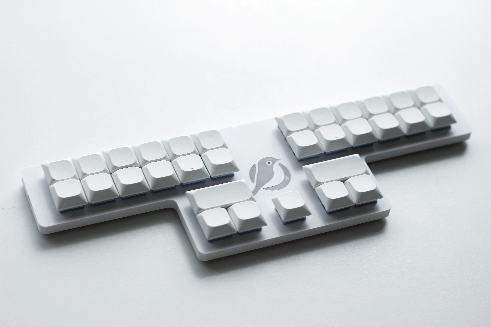

# Mejiro31

## 組み立て方 / How to Build
- [Mejiro31 の組み立て方](/docs/BUILD.md)
- [How to Build Mejiro31](/docs/BUILD_EN.md)

## 使い方 / How to Use
- [Mejiro31 の使い方](/docs/USAGE.md)
- [How to Use Mejiro31](/docs/USAGE_EN.md)

## ファームウェアを選ぶ / Choose Firmware

| ファームウェア / Firmware | 説明 / Guide |
| --- | --- |
| 統一入力エンジン版（ソースからビルド） / Unified engine (build from source) | [日本語](docs/USAGE.md) / [English](docs/USAGE_EN.md) |
| 配布済みv0.4.2（旧仕様） / Released v0.4.2 (legacy) | [日本語](docs/legacy/USAGE.md) / [English](docs/legacy/USAGE_EN.md) |

新版は二段圧縮・Tap/Hold・レイヤー・修飾キーを統一して処理し、外部Ploverとの接続にはPlover HIDを使用します。内蔵メジロ式の変換は共通のRustエンジンを使用します。新版UF2はこのページではまだ配布していません。[ビルドと旧版からの移行](docs/FIRMWARE.md)を参照してください。

The new firmware unifies two-row compression, Tap/Hold, layers and modifiers, and uses Plover HID for external steno. Built-in Mejiro uses the shared Rust engine. New UF2 files are not yet distributed here; see [building and migration](docs/FIRMWARE.md#english).

## v0.4.2のダウンロード（旧仕様） / Legacy v0.4.2 Downloads

以下のUF2は旧ファームウェアです。新版の操作・設定形式・Plover HIDの説明は適用できません。

These UF2 files use the legacy firmware. The new controls, keymap format and Plover HID instructions do not apply.

### 日本語配列用 / Firmware for Japanese Layout
- [QWERTY 配列](https://github.com/JEEBIS27/Mejiro31/releases/download/v0.4.2/mejiro31_jp_qwerty.uf2)
- [Dvorak 配列](https://github.com/JEEBIS27/Mejiro31/releases/download/v0.4.2/mejiro31_jp_dvorak.uf2)
- [Boo 配列](https://github.com/JEEBIS27/Mejiro31/releases/download/v0.4.2/mejiro31_jp_boo.uf2)
- [Colemak 配列](https://github.com/JEEBIS27/Mejiro31/releases/download/v0.4.2/mejiro31_jp_colemak.uf2)
- [Colemak-DH 配列](https://github.com/JEEBIS27/Mejiro31/releases/download/v0.4.2/mejiro31_jp_colemak-dh.uf2)
- [Workman 配列](https://github.com/JEEBIS27/Mejiro31/releases/download/v0.4.2/mejiro31_jp_workman.uf2)
- [Graphite 配列](https://github.com/JEEBIS27/Mejiro31/releases/download/v0.4.2/mejiro31_jp_graphite.uf2)
- [Astarte 配列](https://github.com/JEEBIS27/Mejiro31/releases/download/v0.4.2/mejiro31_jp_astarte.uf2)
- [Eucalyn 配列](https://github.com/JEEBIS27/Mejiro31/releases/download/v0.4.2/mejiro31_jp_eucalyn.uf2)
- [Eucalyn 改](https://github.com/JEEBIS27/Mejiro31/releases/download/v0.4.2/mejiro31_jp_eucalyn-biacco.uf2)
- [Tomisuke 配列](https://github.com/JEEBIS27/Mejiro31/releases/download/v0.4.2/mejiro31_jp_tomisuke.uf2)
- [大西配列](https://github.com/JEEBIS27/Mejiro31/releases/download/v0.4.2/mejiro31_jp_o24.uf2)
- [Merlin 配列](https://github.com/JEEBIS27/Mejiro31/releases/download/v0.4.2/mejiro31_jp_merlin.uf2)
### 英語配列用 / Firmware for English Layout
- [QWERTY Layout](https://github.com/JEEBIS27/Mejiro31/releases/download/v0.4.2/mejiro31_en_qwerty.uf2)
- [Dvorak Layout](https://github.com/JEEBIS27/Mejiro31/releases/download/v0.4.2/mejiro31_en_dvorak.uf2)
- [Boo Layout](https://github.com/JEEBIS27/Mejiro31/releases/download/v0.4.2/mejiro31_en_boo.uf2)
- [Colemak Layout](https://github.com/JEEBIS27/Mejiro31/releases/download/v0.4.2/mejiro31_en_colemak.uf2)
- [Colemak-DH Layout](https://github.com/JEEBIS27/Mejiro31/releases/download/v0.4.2/mejiro31_en_colemak-dh.uf2)
- [Workman Layout](https://github.com/JEEBIS27/Mejiro31/releases/download/v0.4.2/mejiro31_en_workman.uf2)
- [Graphite Layout](https://github.com/JEEBIS27/Mejiro31/releases/download/v0.4.2/mejiro31_en_graphite.uf2)
- [Gallium Layout](https://github.com/JEEBIS27/Mejiro31/releases/download/v0.4.2/mejiro31_en_gallium.uf2)
- [Handsdown-neu Layout](https://github.com/JEEBIS27/Mejiro31/releases/download/v0.4.2/mejiro31_en_handsdown-neu.uf2)
- [Sturdy Layout](https://github.com/JEEBIS27/Mejiro31/releases/download/v0.4.2/mejiro31_en_sturdy.uf2)
- [Canary Layout](https://github.com/JEEBIS27/Mejiro31/releases/download/v0.4.2/mejiro31_en_canary.uf2)
- [Engram Layout](https://github.com/JEEBIS27/Mejiro31/releases/download/v0.4.2/mejiro31_en_engram.uf2)

## ソースコードとビルド / Source and Build

- [ファームウェア / Firmware](https://github.com/JEEBIS27/qmk_firmware/tree/master/keyboards/jeebis/mejiro31)
- [共通メジロ式エンジン / Shared Mejiro engine](https://github.com/JEEBIS27/Mejiro_Engine)
- [ビルド・移行・カスタム / Build, migration and customization](docs/FIRMWARE.md)
