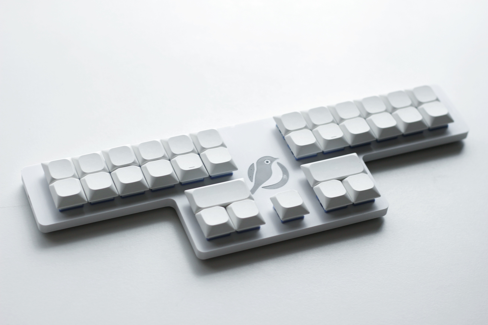

# Mejiro31

[English](README_EN.md)

Mejiro31は、通常のタイピングと速記ができる31キーのキーボードです。

## 購入者向け

- [組み立て方](docs/BUILD.md)
- [キーボードの使い方](docs/USAGE.md)
- [ファームウェア更新とキー設定の手順](docs/CONFIGURATOR.md)
- [設定スタジオを開く](https://jeebis27.github.io/Mejiro31/?lang=ja)

## 開発者向け

- [開発ガイド](docs/DEVELOPMENT.md)
