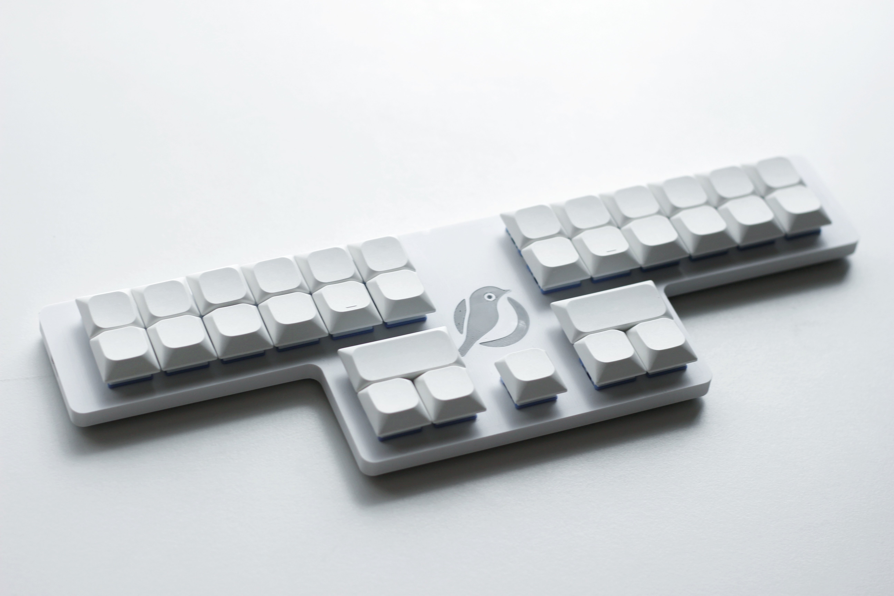

# Mejiro31

[日本語](README.md)

Mejiro31 is a 31-key keyboard for typing and stenography.

## For owners

- [Assemble your keyboard](docs/BUILD_EN.md)
- [Use your keyboard](docs/USAGE_EN.md)
- [Update the firmware and change key assignments](docs/CONFIGURATOR_EN.md)
- [Open the Configurator](https://jeebis27.github.io/Mejiro31/?lang=en)

## For developers

- [Developer guide](docs/DEVELOPMENT_EN.md)
