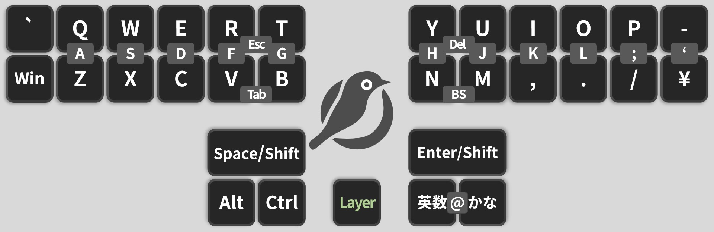
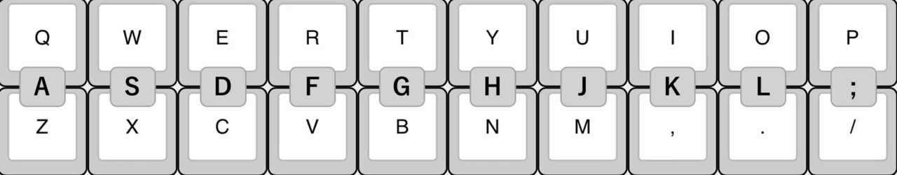
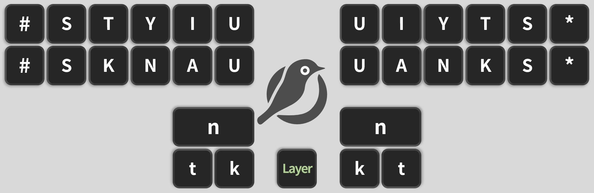

# Mejiro31の使い方

[トップ](../README.md) · [English](USAGE_EN.md) · [ファームウェアの書き込みとキー設定](CONFIGURATOR.md)

[通常入力](#通常入力) · [数字とファンクションキー](#数字とファンクションキー) · [速記](#速記) · [メジロ式のマクロ](#メジロ式のマクロ)

## 通常入力

図は基本QWERTYの位置の目安です。実際の出力は、使用中の配列と保存したキー割り当てに従います。

| キー | 短く押して離す（Tap） | 押したまま別のキーを押す（Hold） |
| --- | --- | --- |
| 中央下の **Layer** | 通常入力と速記を切り替える | 数字レイヤー（NUMBER） |
| 左親指の大きいキー | Space | Shift |
| 右親指の大きいキー | Enter | Shift |

たとえば、大文字の `E` は**左親指の大きいキーを押したまま E**。Shiftとして使った後に親指を離しても、Spaceは入りません。

### 二段圧縮で中段の文字を打つ

基本QWERTYでは、**Eと、その真下のCを一緒に押す → D**。図の小さな灰色の文字は、上下2キーを同時に押したときの出力です。

## 数字とファンクションキー

| やりたいこと | 操作 |
| --- | --- |
| 数字や矢印を入力する | 中央下の **Layer** を押したまま数字や矢印のキーを押す |
| Fキーや音量キーを使う | **Layer** と、右手側の**下段いちばん右**を両方押したまま、使いたいキーを押す |
| 内蔵メジロ式と外部Ploverを切り替える | **Layer** を押したまま、**上段いちばん左**をタップ |
| 代替配列のオン・オフを切り替える | **Layer** を押したまま、**上段いちばん右**をタップ |
| PC側のUS／JIS配列に合わせる | ファンクションレイヤーを開いたまま、**上段いちばん左**をタップ |

最初の2行は、押している間だけ切り替わるレイヤーです。各レイヤーのキー位置や、代替配列・US／JISの設定は[設定スタジオ](https://jeebis27.github.io/Mejiro31/?lang=ja)で確認できます。

## 速記

| 使い方 | 準備 |
| --- | --- |
| **内蔵メジロ式** | キーボードの速記方式を内蔵メジロ式にします。Ploverの起動は不要です。日本語IMEの設定は本体の出力方式に合わせます。 |
| **外部Plover** | Plover 5.1.0以降の設定で **Machine → Plover HID** を選びます。日本語のメジロ式を使う場合は、[Plover版メジロ式の導入手順](https://github.com/JEEBIS27/Plover_Mejiro#導入法installation)に従ってプラグインを入れます。 |

速記方式を選んだら、**中央下のLayerを短く押して離す**と速記に入ります。もう一度タップすると通常入力に戻ります。

メジロ式では、たとえば**左手の `K` と `A` を一緒に押して離す →「か」**。母音・子音や略語は[Plover版メジロ式の使い方](https://github.com/JEEBIS27/Plover_Mejiro#使い方how-to-use)を参照してください。

## メジロ式のマクロ

よく使う入力をマクロに記録すると、1ストロークで再生できます。下の例では左親指の `n` をマクロ名に使います。ストローク表記のハイフンは左右の区切りです。

| 手順 | 打鍵 | 動作 |
| --- | --- | --- |
| 1. 開始 | `#n-*` | 左の `#` と左親指の `n`、右の `*` を同時に押して記録を始める |
| 2. 入力 | 例：`KA-` | 記録したい内容を入力する。この例では「か」 |
| 3. 停止 | `#n-*` | 同じストロークでマクロ `n` の記録を止める |
| 4. 再生 | `#n` | 左の `#` と左親指の `n` を同時に押す。この例では「か」を出力する |

マクロ名は `n`、`t`、`k`、`nt`、`nk`、`tk`、`ntk` の7つです。同じ名前で記録を始めると、前の内容を上書きします。`#-*` でも最後に開始したマクロを停止できます。

| 使用する方式 | マクロに入る内容 |
| --- | --- |
| **Plover版メジロ式** | メジロ式が出力した文字列。[Plover版のマクロ説明](https://github.com/JEEBIS27/Plover_Mejiro#マクロmacro) |
| **内蔵メジロ式（QMK版）** | 速記の出力に加え、記録中に通常入力へ切り替えて入力したキーやショートカット。記録したマクロは電源を切ると消えます。 |

[トップに戻る](../README.md)
