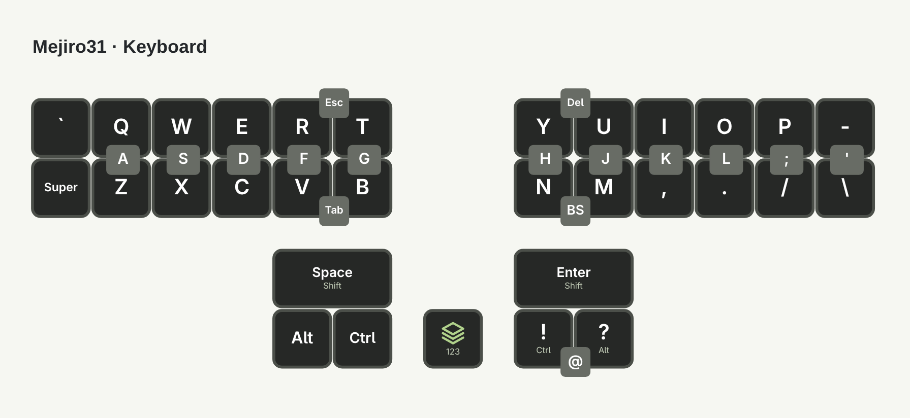
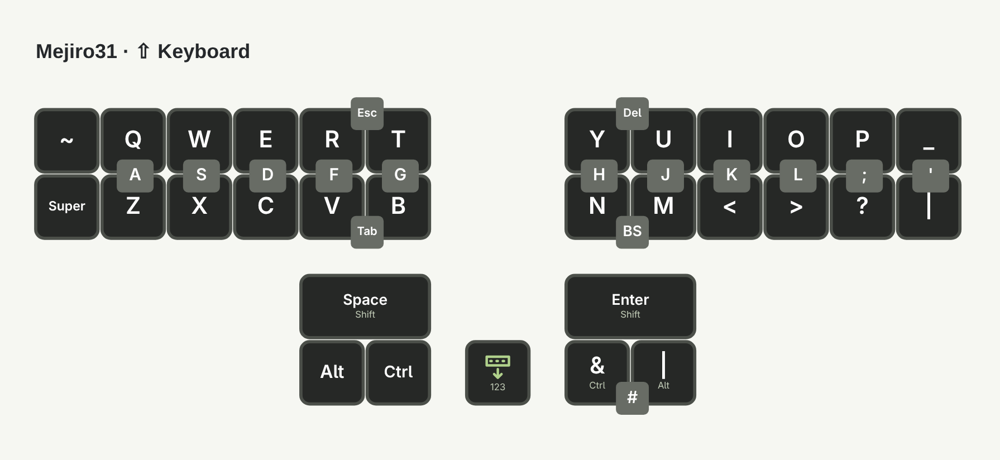
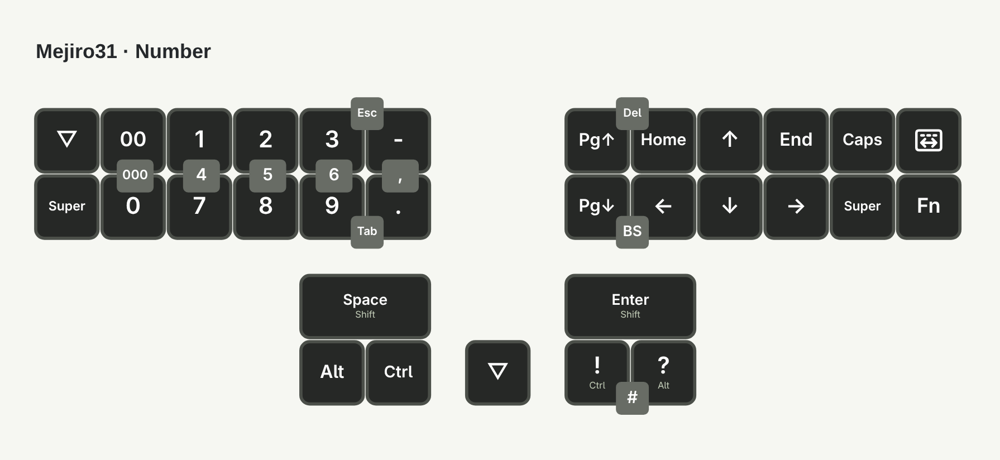
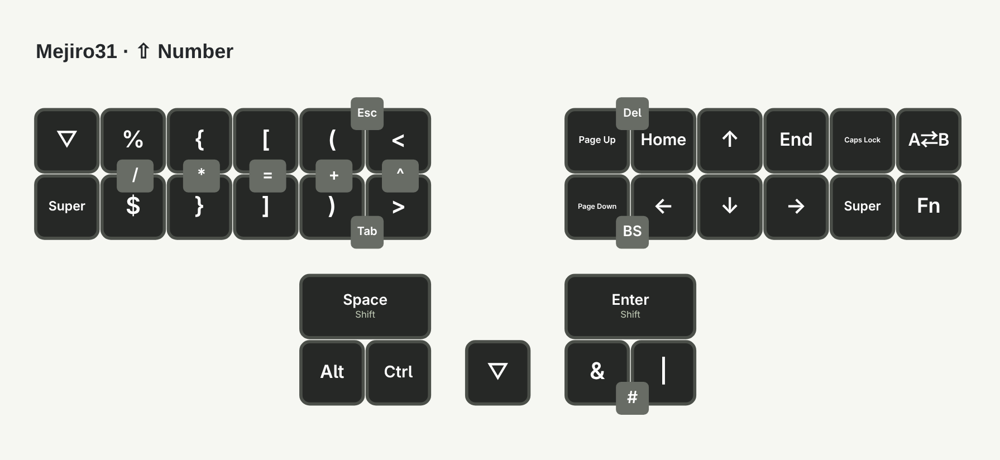
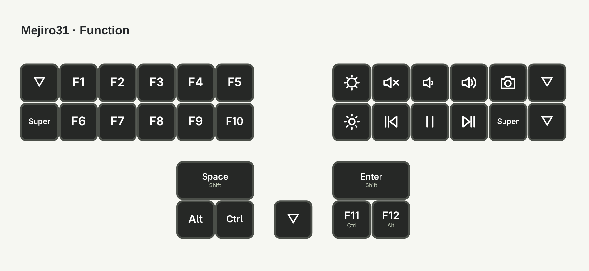
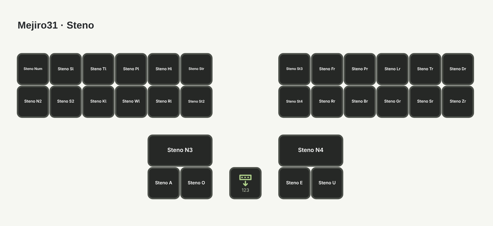

# Using Mejiro31

[Home](../README_EN.md) · [日本語](USAGE.md) · [Flash firmware and change key assignments](CONFIGURATOR_EN.md)

[Typing](#typing) · [Numbers and function keys](#numbers-and-function-keys) · [Steno](#steno) · [Custom keys](#custom-keys)

## Typing

### Keyboard

The diagrams show the default QWERTY preset exported from the Configurator. Small legends below a key show its Hold assignment. Your active layout and saved key assignments determine what the keyboard sends.

| Key | Tap and release | Hold while pressing another key |
| --- | --- | --- |
| Bottom-center **Layer** | Switch between typing and steno | Number layer |
| Large left thumb key | Space | Shift |
| Large right thumb key | Enter | Shift |

For example, **hold the large left thumb key and press E** to type an uppercase `E`. After using the thumb key as Shift, release it to end Shift.

### ⇧ Keyboard

Hold Shift while typing to use this layer.

### Type middle-row letters with two-row compression

In base QWERTY, **press E and the C directly below it together → D**. The small gray labels show what each pair types.

## Numbers and function keys

| To do this | Press these keys |
| --- | --- |
| Type numbers or use the arrows | Hold **Layer** and press the number or arrow key |
| Use F-keys or adjust volume | Hold **Layer** and the **far-right key on the lower row**, then press the desired key |
| Toggle the alternate layout | Hold **Layer** and tap the **far-right key on the upper row** |

Use the [Configurator](https://jeebis27.github.io/Mejiro31/?lang=en) to see the key positions on each layer or change the alternate layout and US/JIS settings.

### Number

Hold the bottom-center Layer key to use this layer.

### ⇧ Number

Hold Shift while using the Number layer to type these symbols.

### Function

While on the Number layer, hold the rightmost key with the **Fn** assignment to use this layer.

## Steno

In Plover 5.1.0 or later, select **Machine → Plover HID**. Tap the bottom-center **Layer** key to enter steno. Tap it again to return to typing.

## Custom keys

| Key | Function | Default assignment |
| --- | --- | --- |
| Keyboard / Steno | Tap to switch between typing and steno. | Bottom center on Keyboard, ⇧ Keyboard, and Steno. Hold to use Number. |
| Alternate layout toggle | Enables or disables the selected alternate layout. | Top-right key on Number and ⇧ Number. |
| `00` | Types two zeros. | Left side of Number. |
| `000` | Types three zeros. | Left side of Number. |
| Sticky Shift | Applies Shift to the next key only. | Assignable as a Tap action in the Configurator. |

| Mejiro / Plover (bird icon) | Switches between built-in Mejiro text output and sending strokes to Plover. | A Japanese preset action. This position uses `▽` here. |
| JIS / US toggle | Switches how the keyboard sends symbols to match the host layout. | A Japanese preset shortcut. This position uses `▽` here. Set the host layout in Keyboard settings. |

`▽` uses the assignment from a lower layer. `—` means unassigned. Hover over a key in the Configurator to see its Tap and Hold actions.

[Back to home](../README_EN.md)
