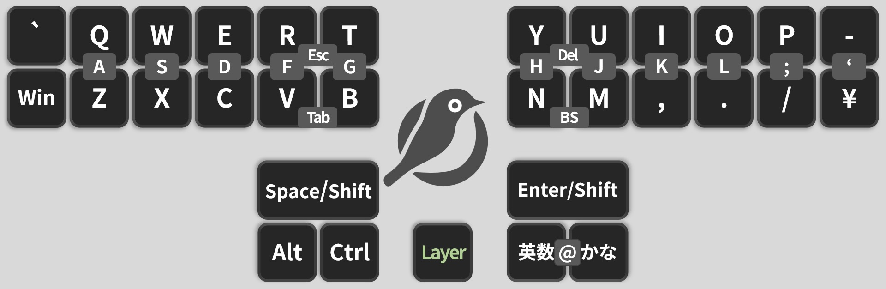
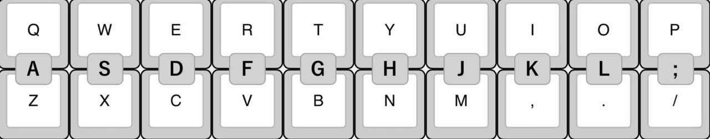
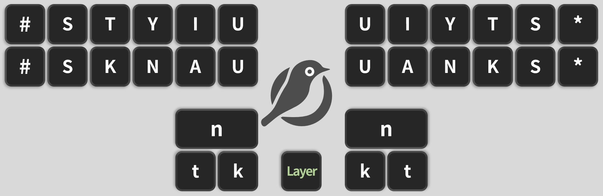

# Using Mejiro31

[Home](../README_EN.md) · [日本語](USAGE.md) · [Flash firmware and change key assignments](CONFIGURATOR_EN.md)

[Typing](#typing) · [Numbers and function keys](#numbers-and-function-keys) · [Steno](#steno) · [Mejiro macros](#mejiro-macros)

## Typing

The diagram shows the base QWERTY positions. Your active layout and saved key assignments determine what the keyboard sends.

| Key | Tap and release | Hold while pressing another key |
| --- | --- | --- |
| Bottom-center **Layer** | Switch between typing and steno | Number layer |
| Large left thumb key | Space | Shift |
| Large right thumb key | Enter | Shift |

For example, **hold the large left thumb key and press E** to type an uppercase `E`. After using the thumb key as Shift, release it to end Shift.

### Type middle-row letters with two-row compression

In base QWERTY, **press E and the C directly below it together → D**. The small gray labels show what each pair types.

## Numbers and function keys

| To do this | Press these keys |
| --- | --- |
| Type numbers or use the arrows | Hold **Layer** and press the number or arrow key |
| Use F-keys or adjust volume | Hold **Layer** and the **far-right key on the lower row**, then press the desired key |
| Switch between built-in Mejiro and external Plover | Hold **Layer** and tap the **far-left key on the upper row** |
| Toggle the alternate layout | Hold **Layer** and tap the **far-right key on the upper row** |
| Match the computer's US or JIS layout | While holding the function layer, tap the **far-left key on the upper row** |

Use the [Configurator](https://jeebis27.github.io/Mejiro31/) to see the key positions on each layer or change the alternate layout and US/JIS settings.

## Steno

| Option | Setup |
| --- | --- |
| **Built-in Mejiro** | Select built-in Mejiro on the keyboard. Set your Japanese IME to match the keyboard's output mode. |
| **External Plover** | In Plover 5.1.0 or later, select **Machine → Plover HID**. For Japanese Mejiro steno, install the plugin using the [Plover Mejiro installation guide](https://github.com/JEEBIS27/Plover_Mejiro#導入法installation). |

After choosing a steno option, **tap the bottom-center Layer key** to enter steno. Tap it again to return to typing.

In Mejiro steno, **press and release the left-hand `K` and `A` together → か**. See the [Plover Mejiro guide](https://github.com/JEEBIS27/Plover_Mejiro#使い方how-to-use) for vowels, consonants, and abbreviations.

## Mejiro macros

Record an input sequence as a macro and replay it with a single stroke. This example uses the left-thumb `n` as the macro name. The hyphen separates left- and right-hand keys in stroke notation.

| Step | Stroke | What happens |
| --- | --- | --- |
| 1. Start | `#n-*` | Press left `#`, left-thumb `n`, and right `*` together to start recording |
| 2. Enter the content | For example, `KA-` | Enter what you want to capture. This example types か |
| 3. Stop | `#n-*` | Use the same stroke to stop recording macro `n` |
| 4. Replay | `#n` | Press left `#` and left-thumb `n` together. This example outputs か |

The seven macro names are `n`, `t`, `k`, `nt`, `nk`, `tk`, and `ntk`. Starting a macro again replaces its previous contents. Use `#-*` to stop the most recently started macro.

| Mejiro option | What the macro captures |
| --- | --- |
| **Plover Mejiro** | Text output by Mejiro steno. See the [Plover macro documentation](https://github.com/JEEBIS27/Plover_Mejiro#マクロmacro). |
| **Built-in Mejiro on QMK** | Steno output and keys or shortcuts entered after switching to normal typing during macro recording. Macros are cleared when the keyboard loses power. |

[Back to home](../README_EN.md)
